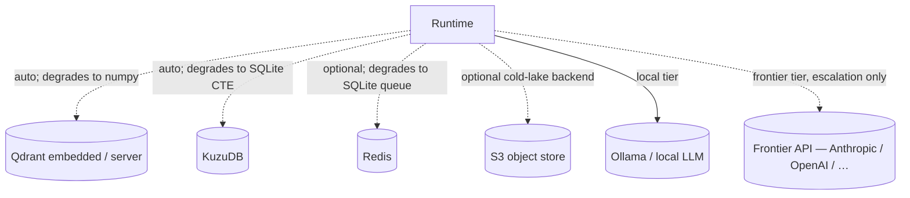

# Component interactions

Verified connections between the major components of PAA. Every relationship is
grounded in an actual import or call site in the source (cited with file and
line). Relationships labelled *runtime* are actual call/flow relationships;
relationships labelled *import* are compile-time dependencies that may not be
invoked on every request.

## 1. Top-level dependency graph

```mermaid
flowchart TD
    CLI[CLI: paa submit/serve/agent]
    API[FastAPI ingestion API]
    RT[Runtime.build() — composition root]
    ORCH[ChiefOrchestrator — task lifecycle]
    LEDGER[LedgerStore — append-only event log]
    DB[Database — SQLite WAL relational]
    AGENTS[Agent hierarchy: planner, policy, worker, critic, context builders, router]
    MODEL[EscalatingModelRouter — local→frontier]
    VEC[Vector store — Qdrant / numpy]
    GRAPH[Graph store — Kuzu / SQLite CTE]
    QUEUE[Durable queue — SQLite / Redis]
    COLD[Cold lake — content-addressed blobs]
    SANDBOX[Sandbox backend — subprocess / WSL / Docker / dryrun]
    VALID[Deterministic validation — AST, patch, drift, tests]
    CONTEXT[Bounded context gatherer]
    MEMORY[Memory domains, decay, creator/curator]
    CODER[Coder agent loop + permissions + hooks]
    DAEMON[Daemon loops — dispatch, ingestion, maintenance]

    CLI --> RT
    API --> RT
    RT --> ORCH
    RT --> LEDGER
    RT --> DB
    RT --> AGENTS
    RT --> MODEL
    RT --> VEC
    RT --> GRAPH
    RT --> QUEUE
    RT --> COLD
    RT --> SANDBOX
    ORCH --> LEDGER
    ORCH --> AGENTS
    ORCH --> QUEUE
    AGENTS --> MODEL
    AGENTS --> CONTEXT
    AGENTS --> SANDBOX
    AGENTS --> VALID
    CONTEXT --> DB
    CONTEXT --> VEC
    CONTEXT --> GRAPH
    MEMORY --> DB
    MEMORY --> VEC
    DAEMON --> ORCH
    DAEMON --> MEMORY
    CODER --> RT
    CODER --> MODEL
```

External / optional services (degrading):



## 2. Component inventory

| Component | Responsibility | Entry point | Key dependencies | Consumers | State / side effects |
|---|---|---|---|---|---|
| `Runtime` (`runtime.py:151`) | Composition root; builds and closes the whole runtime; drives tasks | `Runtime.build()` (`runtime.py:260`) | `Database`, `LedgerStore`, agents, model router, storage substrates, recovery engine | CLI, API, daemon, coder agent | Opens DB; creates directories; runs boot recovery |
| `ChiefOrchestrator` (`agents/orchestrator.py:188`) | Task lifecycle: hydrate → plan → policy → execute → commit; owns delegation graph and backpressure | `ChiefOrchestrator.run()` (`orchestrator.py:396`) | `LedgerStore`, all agents, queue, backpressure, recovery | `Runtime`, API (`/tasks`), daemon dispatch loop | Writes ledger events; enqueues tasks |
| `LedgerStore` (`ledger/store.py:108`) | Append-only event log; idempotency, state_version, hash chain, head projection | `LedgerStore.append()` (`ledger/store.py:116`) | `Database` | Orchestrator, recovery, replay, API (`/ledger/{id}`), CLI (`paa ledger`) | Appends rows to `system_state_ledger`; updates `system_state_correlation_head` |
| `Database` (`storage/relational/database.py:110`) | Async SQLite access layer; single writer + read pool; WAL | `Database.connect()` (`storage/relational/database.py:168`) | `aiosqlite`, `sqlite3` | Nearly every storage-writing/reading module | Creates/mutates `paa.db`; applies schema on connect |
| `StrategicPlanner` (`agents/reasoning.py:62`) | Compiles a goal + context into ordered execution steps | `StrategicPlanner.handle()` (`reasoning.py:78`) | `ModelLike` (model adapter); `MODALITY_PROFILES` | Orchestrator (`_plan`) | Emits no events directly; returns plan dict |
| `PolicyRiskAgent` (`agents/policy.py:132`) | Deterministic risk gate; no model consulted | `PolicyRiskAgent.handle()` (`policy.py:158`) | `Database` (policy rules), vector store + embedder (anti-goals), `PolicySettings` | Orchestrator (`_check_policy`) | Reads `hot_serving_policy_rules`; returns verdict dict |
| `CriticReviewer` (`agents/reasoning.py:194`) | Reviews worker output; deterministic validation first, model second | `CriticReviewer.handle()` (`reasoning.py:221`) | `ModelLike`, `DeterministicValidationEngine` | Orchestrator (`_critique`) | Returns verdict (`PASS`/`FAIL_REJECT_RETRY`/`FAIL_ESCALATE`) |
| `WorkerCell` (`agents/reasoning.py:413`) | Executes one plan step inside a sandbox | `WorkerCell.handle()` (`reasoning.py:431`) | `Sandbox` backend, `SandboxSpec` | Orchestrator (`_execute_steps`) | Runs sandboxed process; returns patch/stdout |
| `PlannerContextBuilder` / `WorkerContextBuilder` (`agents/context_agents.py:295`) | Build context packets (planner: all domains; worker: narrative blocked) | `.handle()` | `Database`, vector, graph, embedder, `BoundedContextGatherer` | Orchestrator (`_hydrate`) | Read-only fetches; no writes |
| `BoundedContextGatherer` (`context/gatherer.py`) | Enforces hard token ceiling on context packet | `compile()` | `TokenBudget`, `CharEstimator` | Context builders | Pure computation; no persistence |
| `EscalatingModelRouter` (`models/router.py:165`) | Local-first routing with explicit, logged escalation to frontier | `complete()` / `complete_structured()` | Local provider, optional frontier provider, `LedgerStore` | `RouterModelAdapter` (via agents) | Writes `MODEL_ESCALATED` ledger event before frontier call |
| `RouterModelAdapter` (`runtime.py:109`) | Bridges agents' `ModelLike` protocol to the escalation router | `complete_structured()` (`runtime.py:132`) | `EscalatingModelRouter` | All reasoning agents | No persistence (router logs escalations) |
| `RecoveryEngine` (`ledger/recovery.py:140`) | Post-crash boot sweep: replay, reconcile workspace, re-queue | `RecoveryEngine.boot_sweep()` (`recovery.py:226`) | `LedgerStore`, `Database`, optional `WorkspaceSnapshotter`, optional queue requeuer | `ChiefOrchestrator.boot()` (`orchestrator.py:1104`) | Writes `RECOVERY_REPLAY_COMPLETED`/`STATE_ROLLBACK_TRIGGERED`/`TASK_ABANDONED` events; restores workspace |
| `Daemon` (`daemon.py:42`) | Background loops: dispatch, ingestion, maintenance | `Daemon.start()` (`daemon.py:62`) | `Runtime`, `MemoryCreator`, `DecaySweeper` | `paa serve` (`cli/main.py:289`) | Claims queue messages; runs decay sweep; ingests signals |
| `MemoryCreator` (`memory/creator.py`) | Ingests unprocessed signals into hot-serving facts | `MemoryCreator.run_batch()` | `Database`, `FactRepository` | Daemon ingestion loop | Writes entities/facts |
| `DecaySweeper` (`memory/decay.py`) | Evicts stale facts via `C(t)=C₀·e⁻ˡᵃᵐᵇᵈᵃ·t` | `DecaySweeper.sweep()` | `Database`, `DomainPolicy` | Daemon maintenance loop | Deletes/archives stale fact rows |
| `DeterministicValidationEngine` (`validation/engine.py:185`) | Binary PASS/FAIL: schema → AST → patch → drift → tests | `validate()` (`engine.py:208`) | `AstSecurityScanner`, `SchemaValidator`, `UnifiedDiffValidator`, `WorkspaceSnapshot`, optional `PytestRunner`/`Sandbox` | `CriticValidatorAdapter` (`runtime.py:76`) | Runs tests in sandbox (only check that executes code) |
| `CoderAgent` (`coder/agent.py:71`) | Tool-using loop over the runtime | `CoderAgent.build()` (`coder/agent.py:105`) | `Runtime`, `AgentLoop`, `RouterToolCallingModel`, `ToolPermissionPolicy`, `HookRegistry`, `Session` | `paa agent` CLI (`cli/coder.py`) | Submits/runs tasks via runtime tools; writes session transcripts |
| `AgentLoop` (`coder/loop.py:116`) | think → act → observe under permissions & hooks | `AgentLoop.run()` (`loop.py:142`) | `ToolCallingModel`, `ToolPermissionPolicy`, `HookRegistry`, `Session` | `CoderAgent.ask()` | Records turns; calls tools; mutates session transcript |
| `SignalRepository` (`storage/coldlake/signals.py:102`) | Raw signal intake; idempotent on (channel, external_id); CAS offload | `SignalRepository.record()` (`signals.py:127`) | `Database`, `ContentAddressedStore` | API (`/signals`), daemon ingestion | Writes `cold_lake_signals`; offloads blobs to CAS |
| `ContentAddressedStore` (`storage/coldlake/cas.py:147`) | Content-addressed, zstd-compressed blob store | `put()` / `get()` | `zstandard`, filesystem | `SignalRepository`, `copy_file_into` | Writes blobs under `cold_lake/blobs/<sha2>/<sha>.zst` |

## 3. Verified call chains

### Chain A: Task submission and execution (the main path)

```
CLI `paa submit` (cli/main.py:61)
  → Runtime.submit() (runtime.py:189)
    → ChiefOrchestrator.submit() (orchestrator.py:188)
      → LedgerStore.append(TASK_REQUESTED) (store.py:113)
      → LedgerStore.append(TASK_QUEUED)
      → queue.enqueue(StreamName.ORCHESTRATOR_CORE) (orchestrator.py:233)
CLI `paa run <id>` / daemon dispatch / API `?run=true`
  → Runtime.run() (runtime.py:209)
    → ChiefOrchestrator.run() (orchestrator.py:292)
      → project(ledger, cid) (replay.py:322)
      → _hydrate → context builder (context_agents.py:241)
      → _plan → planner (reasoning.py:78)
      → _check_policy → policy agent (policy.py:139)
      → _execute_steps: per step
        → EXECUTION_STARTED (ledger)
        → WorkerCell.handle → sandbox.run (reasoning.py:431)
        → CriticReviewer.handle → validation engine (validation/engine.py:208)
        → EXECUTION_COMPLETED / VALIDATION_FAILED (ledger)
      → _commit → MUTATION_COMMITTED (ledger)
```

### Chain B: Model call with escalation

```
Agent.handle (reasoning.py)
  → RouterModelAdapter.complete_structured (runtime.py:121)
    → EscalatingModelRouter.complete_structured (router.py:274)
      → evaluate(modality, permission_mode) (router.py:203)
        → local provider first
        → on StructuredOutputError / ModelUnavailableError → escalate
          → _record_escalation → LedgerStore.append(MODEL_ESCALATED) BEFORE frontier call (router.py:417)
          → frontier provider
```

### Chain C: Signal ingestion → memory creation

```
API POST /signals (api/app.py:166)
  → SignalRepository.record() (signals.py:124)
    → cold_lake_signals row (+ CAS blob if oversized)
Daemon ingestion loop (daemon.py:139)
  → MemoryCreator.run_batch() (memory/creator.py)
    → claim_unprocessed signals
    → FactRepository.add_fact / upsert_entity (memory/facts.py:429)
      → hot_serving_active_facts / hot_serving_entity_index
```

### Chain D: Crash recovery (boot sweep)

```
paa recover / Daemon.start → Runtime.boot_recovery()
  → ChiefOrchestrator.boot() (orchestrator.py:737)
    → RecoveryEngine.boot_sweep() (recovery.py:222)
      → verify_all_chains() (store.py:349)
      → open_correlations() (store.py:278)  — from head projection, not queue
      → per lineage: project() (replay.py:322)
        → if AWAITING_HUMAN → PARKED_HUMAN (never auto-clear)
        → if attempts >= max → TASK_ABANDONED
        → _reconcile_workspace: manifest vs disk; drift → restore + STATE_ROLLBACK_TRIGGERED
        → _requeue → queue.enqueue
        → RECOVERY_REPLAY_COMPLETED audit event
```

### Chain E: Coder agent tool call

```
paa agent "prompt" (cli/coder.py:44)
  → CoderAgent.build() (coder/agent.py:101) → Runtime.build()
    → AgentLoop.run() (loop.py:142)
      → RouterToolCallingModel.propose() (model_adapter.py:161)
        → EscalatingModelRouter.complete_structured (router.py:274)
      → for each tool call:
        → HookRegistry.fire(PRE_TOOL_USE) (hooks.py:95)
        → ToolPermissionPolicy.evaluate() (permissions.py:172)
        → confirm callback on ASK (loop.py:231)
        → tool.run() → build_runtime_tools tool (runtime_tools.py)
          → e.g. submit_task → Runtime.submit() (runtime.py:189)
          → e.g. run_task → Runtime.run() (runtime.py:209)
        → HookRegistry.fire(POST_TOOL_USE)
```

## 4. Data-dependency relationships

| Data | Produced by | Consumed by | Persisted where | Derived or durable? |
|---|---|---|---|---|
| Ledger events | Orchestrator, recovery, router (escalation) | Replay, recovery, API `/ledger/{id}`, CLI `paa ledger` | `system_state_ledger` (SQLite) | Durable (source of truth) |
| Task projection | `project()` (replay.py) | Orchestrator `run`, API task status, CLI `paa status` | Derived (recomputed from ledger) | Derived |
| Context packet | Context builders | Planner | Not persisted (rebuilt per hydrate) | Derived |
| Plan steps | StrategicPlanner | Orchestrator `_execute_steps` | In ledger payload (PLAN_COMPILED) | Durable (via ledger) |
| Worker output (patch/stdout) | WorkerCell (sandbox) | Critic, orchestrator | Not persisted unless committed | Ephemeral |
| Validation report | DeterministicValidationEngine | Critic | In ledger payload (CRITIQUE_CONCLUDED) | Durable (via ledger) |
| Entities/facts | MemoryCreator | Context gatherer, planner | `hot_serving_entity_index`, `hot_serving_active_facts` | Durable (hot serving) |
| Vectors | Embedder + MemoryCreator | Context gatherer (semantic search) | Vector store (Qdrant/numpy) | Derived (rebuildable from facts) |
| Graph edges | MemoryCreator | Context gatherer (graph hops) | Graph store (Kuzu/SQLite CTE) | Derived |
| Queue messages | Orchestrator submit, recovery requeue | Daemon dispatch loop | `queue_messages` (SQLite) or Redis | Durable (SQLite) / volatile (Redis) |
| Recovery marks | RecoveryEngine.checkpoint | RecoveryEngine `_reconcile_workspace` | `hot_serving_recovery_marks` | Durable |
| Session transcript | AgentLoop / Session | Coder agent | JSONL under `PAA_HOME/sessions` | Durable |

## 5. Relationship rules observed in this codebase

- **Ledger before side effect:** Every orchestrator phase writes its event
  (`_emit`) before calling the agent or doing the work
  (`orchestrator.py:467`–`:811`).
- **No model in control path:** `PolicyRiskAgent` has no provider dependency
  (`policy.py:7`); routing/gating are pure Python.
- **Orchestrator mediates all delegation:** Agents call `self.delegate()` which
  routes through `ChiefOrchestrator.mediate_delegation` (`agents/base.py:373`,
  `orchestrator.py:833`); the `DelegationGraph` enforces depth/cycle/node
  bounds (`delegation.py:87`).
- **Storage substrates degrade, never raise:** `_try_vector/_try_graph/_try_queue`
  catch all exceptions and return `None` with a warning (`runtime.py:387`).
- **Sandbox probe is bounded at 5s:** `_acquire_sandbox` uses
  `asyncio.wait_for(..., timeout=5.0)` then falls back to subprocess
  (`runtime.py:431`).
- **API is an edge layer only:** `create_app` parses/validates and delegates to
  `Runtime`; it holds no application state and makes no model calls
  (`api/app.py:52`).
- **Everything is injected:** `Runtime.build` accepts `model_adapter`,
  `model_router` overrides; agents take their collaborators in constructors
  (`runtime.py:260`).

## 6. What would break if changed or removed

| Change | Likely blast radius |
|---|---|
| Change `EventType` vocabulary | Must also touch `replay.py::_PHASE_MAP`, `store.py` (`TERMINAL_EVENTS` in `_update_head`), and `orchestrator.py` emitters (`AGENTS.md:88`) |
| Remove `LedgerStore.append` idempotency | Retries would duplicate events; breaks at-least-once → effectively-once (`events.py:68`) |
| Change `canonical_json` serialization | Breaks the hash chain; all existing `event_hash` values invalid (data migration) (`events.py:40`) |
| Remove `Database` single write lock | Concurrent appends could collide on `uq_ledger_version` (`ledger/store.py:12`) |
| Make policy model-driven | Violates the "no model in control path / security loop" guarantee (`policy.py:7`) |
| Remove sandbox from WorkerCell | Worker would execute on host; loses containment (`reasoning.py:441`) |
| Delete `system_state_correlation_head` | Recovery would have to scan the full ledger instead of open lineages (`ledger/store.py:348`) |
| Change `TERMINAL_EVENTS` | Recovery sweep would either re-process finished tasks or abandon in-flight ones (`core/types.py:187`) |

## 7. Related documents

- [`architecture/overview.md`](overview.md) — design patterns and the ledger-is-truth invariant.
- [`architecture/repository-map.md`](repository-map.md) — directory and module map.
- [`modules/ledger.md`](../modules/ledger.md) — ledger deep dive.
- [`modules/agents.md`](../modules/agents.md) — agent hierarchy deep dive.
- [`modules/storage.md`](../modules/storage.md) — storage substrates deep dive.
- [`flows/workflow-01-submit-and-run.md`](../flows/workflow-01-submit-and-run.md) — traced main-path execution.
