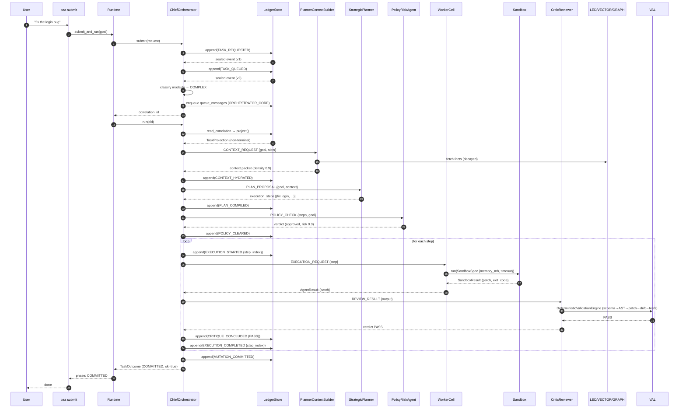

# Workflow 01 — Submit and run a task to completion

Traces `paa submit "fix the login bug"` (or `POST /tasks?run=true`) from entry
to `MUTATION_COMMITTED`. All paths verified against `src/paa/agents/orchestrator.py`.

## Trigger

| Trigger | Entry | File |
|---|---|---|
| CLI | `paa submit "fix the login bug"` | `cli/main.py:73` → `Runtime.submit()` |
| API | `POST /tasks?run=true` | `api/app.py:85` → `Runtime.submit()` + `Runtime.run()` |
| Programmatic | `rt.submit_and_run("...")` | `runtime.py:213` |

## Step-by-step execution

### 1. Submit — durable intake

`ChiefOrchestrator.submit()` (`orchestrator.py:188`):
1. Mint `CorrelationId` (`new_correlation_id()`, `core/types.py:50`).
2. Classify modality (`_classify()`, `orchestrator.py:247`) — heuristic: keywords
   (`refactor`, `implement`, `build`, `debug`, `fix`) → `COMPLEX`; `migrate`/`redesign`
   → `MAX`; target agent + short goal → `SIMPLE`; else `STANDARD`.
3. Emit `TASK_REQUESTED` (`_emit()`, `orchestrator.py:263`) → `LedgerStore.append()`
   (`ledger/store.py:116`) → row in `system_state_ledger`, head projection upserted.
4. Apply backpressure (`_apply_backpressure()` — may degrade modality if queue
   deep, `orchestrator.py:264`; `backpressure.py:77`).
5. Emit `TASK_QUEUED`.
6. If queue configured: `queue.enqueue(StreamName.ORCHESTRATOR_CORE,
   {correlation_id, goal})` (`orchestrator.py:233`) → `queue_messages`.

Return `correlation_id` to caller. Submission does **not** execute — the request
is durable before any work (`orchestrator.py` docstring).

### 2. Run — project existing state

`ChiefOrchestrator.run(cid)` (`orchestrator.py:292`):
1. `project(ledger, cid)` (`replay.py:322`) → `TaskProjection`.
2. If `state.is_terminal`, return immediately (`:295`).
3. Build `AgentContext` from `MODALITY_PROFILES[state.modality]` (`_context_for`,
   `:327`) — token budget, permission mode, recursion depth.

### 3. Hydrate — build context packet

`_hydrate()` (`orchestrator.py:467`):
1. Skip if `context_packet` already present (resume).
2. Emit `CONTEXT_HYDRATION_REQUESTED`.
3. `PlannerContextBuilder.run(message, ctx)` (`context_agents.py:241`):
   - Expand goal → terms + slots (`_KeywordExpander` or AI expander).
   - `_hot_facts()` — relational candidates, confidence decayed at read time
     (`effective_confidence`, `decay.py`).
   - `_semantic()` — vector search (if vector store + embedder).
   - `_graph_neighbours()` — bounded traversal by `graph_hops`.
   - `BoundedContextGatherer.compile()` packs within `token_ceiling` (1500).
4. If `routing_directive == HARD_STOP_ESCALATE_TO_USER` → emit
   `AWAITING_HUMAN_ATTESTATION` (parks; `:379`), return.
5. Emit `CONTEXT_HYDRATED` with `context_packet` (`orchestrator.py:534`).

### 4. Plan — compile execution steps

`_plan()` (`orchestrator.py:542`):
1. Skip if `plan_steps` already present (resume).
2. SIMPLE: emit `PLAN_COMPILED` with one step (`{action: goal, agent: worker}`,
   `bypassed_planner: true`) (`:408`).
3. Else `StrategicPlanner.run(message, ctx)` (`reasoning.py:78`):
   - Model `complete_structured` with `_PLAN_SCHEMA` (requires `execution_steps`)
     (`reasoning.py:95`); one retry on failure (`:93`); deterministic fallback
     splits goal on conjunctions (`:129`).
   - `_normalise()` preserves passthrough keys (`command`, `required_permissions`,
     `path`, `risk_profile`, ...) — security requirement (`:155`).
   - Validate `len(steps) <= max_plan_nodes()`; else `RecursionGuardError`
     (`:441`).
4. Emit `PLAN_COMPILED` with `execution_steps` + `step_requirements` (`:448`).

### 5. Policy — deterministic risk gate

`_check_policy()` (`orchestrator.py:461`):
1. Skip if `policy_decision` already present (resume).
2. `PolicyRiskAgent.run(message, ctx)` (`policy.py:139`):
   - Permissions check (`:174`), LOCKDOWN network (`:194`), irreversible ops
     under SAFE (`:213`), paths (`:222`), operator rules from DB (`:234`),
     anti-goals (cosine ≥ 0.82 or phrase match, `:262`).
   - Risk score [0,1]; `_needs_gate()` decides human-gate need by mode (`:318`).
3. Blocked → `POLICY_BLOCKED` (or `SECURITY_VIOLATION` on anti-goal) → phase
   `BLOCKED` (terminal) (`orchestrator.py:673`).
4. Human gate required → `AWAITING_HUMAN_ATTESTATION` → phase parks (`orchestrator.py:909`).
5. Cleared → `POLICY_CLEARED` + `risk_score` → phase `EXECUTING` (`orchestrator.py:709`).

### 6. Execute steps — per step in sandbox

`_execute_steps()` (`orchestrator.py:515`). For each step not in
`completed_steps`:

```
for attempt in 0..max_step_retries (default 2):
    emit EXECUTION_STARTED {step_index, step, attempt, discriminator="step-N"}
    WorkerCell.handle(message, ctx)  (reasoning.py:431)
        → SandboxSpec from modality profile (memory_mb, cpu_cores, timeout)
        → sandbox.run(spec) → SandboxResult
        → exit_code != 0 or timed_out → AgentResult.failure
        → else → AgentResult.success({patch, stdout, exit_code})
    CriticReviewer (if configured):
        → DeterministicValidationEngine first (validation/engine.py:208)
        → model review second (can only downgrade)
        → emit CRITIQUE_CONCLUDED {step_index, verdict}
    if passed: emit EXECUTION_COMPLETED {step_index, tokens}; break
    else: emit VALIDATION_FAILED {step_index, attempt}; retry
on budget exhausted: raise PaaError → EXECUTION_FAILED (terminal)
```

`EXECUTION_COMPLETED` fires **per step**, not per task; phase stays `EXECUTING`
until all steps done (`replay.py:239`, ADR-0010). Re-project after each step
(`orchestrator.py:577`).

### 7. Commit — terminal

`_commit()` (`orchestrator.py:609`): emit `MUTATION_COMMITTED`
{steps_completed, tokens_consumed}; phase `COMMITTED` (terminal).

## Sequence diagram



## Persistence points

| What | Store | Table |
|---|---|---|
| TASK_REQUESTED/TASK_QUEUED | LedgerStore | `system_state_ledger` |
| Head projection | LedgerStore | `system_state_correlation_head` |
| Queue message | Queue | `queue_messages` |
| Every phase event | LedgerStore | `system_state_ledger` |
| Context packet | ledger payload (CONTEXT_HYDRATED) | `system_state_ledger` |
| Plan steps | ledger payload (PLAN_COMPILED) | `system_state_ledger` |
| Patch/stdout | ledger payload (EXECUTION_COMPLETED) | `system_state_ledger` |
| MUTATION_COMMITTED | LedgerStore | `system_state_ledger` |

## Alternative / failure paths

| Condition | Resulting event | Phase | Recoverable |
|---|---|---|---|
| Policy blocks plan | `POLICY_BLOCKED` | BLOCKED | Terminal |
| Anti-goal match | `SECURITY_VIOLATION` | BLOCKED | Terminal |
| Human gate required | `AWAITING_HUMAN_ATTESTATION` | AWAITING_HUMAN | Parks; external `clear_human_gate` |
| Step exceeds retry budget | `EXECUTION_FAILED` | FAILED | Via recovery sweep |
| Crash mid-execution | (event already written) | per projection | Via recovery sweep |

## Related documents

- [`backend/request-lifecycle.md`](../backend/request-lifecycle.md) — phase reference.
- [`modules/ledger.md`](../modules/ledger.md) — event vocabulary.
- [`modules/agents.md`](../modules/agents.md) — agents involved.
- [`modules/validation.md`](../modules/validation.md) — critic validation.
- [`modules/sandbox.md`](../modules/sandbox.md) — WorkerCell sandbox.
- [`flows/workflow-02-human-gate.md`](workflow-02-human-gate.md) — the park branch.
- [`flows/workflow-03-crash-recovery.md`](workflow-03-crash-recovery.md) — the crash branch.
