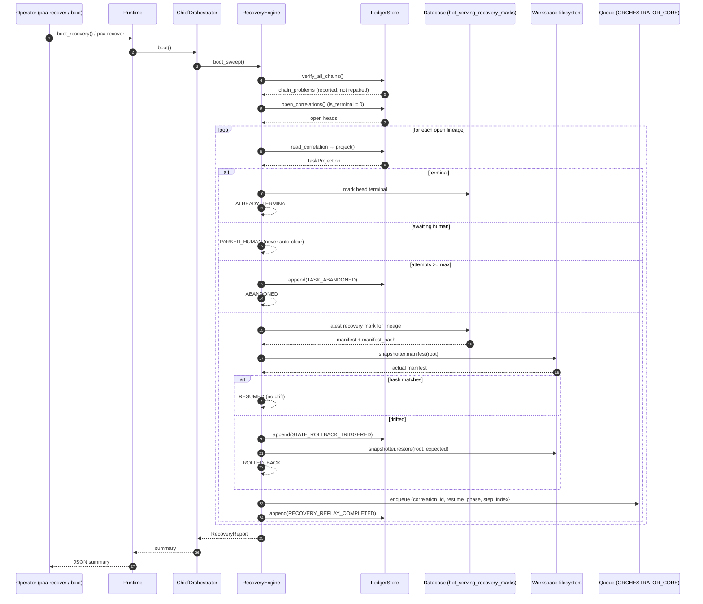

# Workflow 03 — Crash recovery (boot sweep)

Traces what happens when the process dies mid-task and is restarted.
Verified against `src/paa/ledger/recovery.py`, `src/paa/ledger/store.py`,
`src/paa/ledger/replay.py`, `src/paa/agents/orchestrator.py`.

## Trigger

| Trigger | Entry | File |
|---|---|---|
| CLI | `paa recover` | `cli/main.py:191` → `Runtime.boot_recovery()` |
| Service start | `paa serve` → `Daemon.start()` | `daemon.py:64` |
| Runtime build | `Runtime.build(run_recovery=True)` (default) | `runtime.py:331` |

All lead to `ChiefOrchestrator.boot()` → `RecoveryEngine.boot_sweep()`.

## Step-by-step sweep

`RecoveryEngine.boot_sweep(limit=1000)` (`recovery.py:222`):

### 1. Verify hash chains

`verify_all_chains()` (`ledger/store.py:435`): for every lineage, `verify_chain()` checks
each event's digest recomputes, `prev_hash` links to predecessor, versions dense.
Problems are **reported, never auto-repaired** (`recovery.py:231`) — silently
fixing tampered history defeats auditability.

### 2. Enumerate open lineages

`open_correlations()` (`ledger/store.py:348`) reads `WHERE is_terminal = 0
ORDER BY updated_at ASC` from the **head projection** — deliberately **not**
the queue (`recovery.py:11`), because the queue is volatile and may have lost
messages; the ledger is not.

### 3. Recover each lineage (`recover_correlation`, `recovery.py:263`)

For each head:

a. `project(store, cid)` → `TaskProjection` (replay from ledger, `ledger/replay.py:322`).
b. If `projection.is_terminal` → head projection lagged (crash between ledger
   insert and head upsert); `_mark_head_terminal()`; outcome `ALREADY_TERMINAL`
   (`:270`).
c. If `phase is AWAITING_HUMAN` → `PARKED_HUMAN`; a crash is never consent
   (`:274`).
d. If `attempts >= max_attempts` → `TASK_ABANDONED` event; outcome `ABANDONED`
   (`:285`).
e. `_reconcile_workspace(projection)` (`:350`):
   - Read latest `hot_serving_recovery_marks` checkpoint for the lineage.
   - Compare live filesystem manifest vs checkpoint hash.
   - Match → no drift (`[], []`).
   - Drift → `STATE_ROLLBACK_TRIGGERED` event with drifted/restored paths
     (`:394`); `snapshotter.restore(root, expected)`; outcome `ROLLED_BACK`.
   - No checkpoint ever taken → nothing can have drifted (`:366`).
f. `_requeue(projection)` (`:437`): enqueue to `StreamName.ORCHESTRATOR_CORE`
   with `{correlation_id, session_id, resume_phase, resume_step_index,
   recovered: true}`. Enqueue failure logged, non-fatal — ledger already
   records the task as open, so a later sweep retries (`recovery.py:444`).
g. `_record_sweep()` (`:306`): append `RECOVERY_REPLAY_COMPLETED` audit event,
   suppressed if the latest event is already one (keeps repeated sweeps
   no-op; ADR-0010 idempotency fix) (`:329`).

## Outcomes

| Outcome | Meaning | Re-queued? |
|---|---|---|
| `RESUMED` | Clean state; continue where left off | Yes |
| `ROLLED_BACK` | Workspace drifted; restored to checkpoint, then resume | Yes |
| `PARKED_HUMAN` | Waiting on human gate; left parked | No |
| `ABANDONED` | Attempts ≥ max; closed out | No |
| `UNRECOVERABLE` | Lineage error during sweep | No |
| `ALREADY_TERMINAL` | Head projection lagged; task actually finished | No |

`RecoveryReport` aggregates `started_at`, `finished_at`, `scanned`,
`recoveries[]`, `chain_problems` (`recovery.py:115`).

## Idempotency

Recovery is idempotent: running twice yields the same end state
(`recovery.py:17`). A crash during recovery is survivable because each sweep
re-reads the ledger and the audit-event suppression prevents unbounded growth
(`recovery.py:306`).

## Sequence diagram

## What the daemon does next

The daemon dispatch loop (`daemon.py:116`) claims the re-queued messages and
runs each via `Runtime.run(cid)`, which re-projects and resumes at
`resume_step_index` (`orchestrator.py:519`, `replay.py` `completed_steps`).

## Failure behavior

| Failure | Handling |
|---|---|
| Hash-chain problem | Reported in `RecoveryReport.chain_problems`, never repaired (`recovery.py:231`) |
| Single lineage throws | Logged as `UNRECOVERABLE`; sweep continues (`recovery.py:250`) |
| Requeue fails | Logged non-fatal; ledger already open; next sweep retries (`recovery.py:444`) |
| Workspace missing | Logged warning, no drift recorded (`recovery.py:371`) |
| No checkpoint taken | Nothing can have drifted (`recovery.py:366`) |

## Persistence

| Write | Store | Table |
|---|---|---|
| `STATE_ROLLBACK_TRIGGERED` | LedgerStore | `system_state_ledger` |
| `TASK_ABANDONED` | LedgerStore | `system_state_ledger` |
| `RECOVERY_REPLAY_COMPLETED` | LedgerStore | `system_state_ledger` |
| Head `is_terminal` repair | Database | `system_state_correlation_head` |
| Checkpoint | Database | `hot_serving_recovery_marks` |

## Related documents

- [`modules/ledger.md`](../modules/ledger.md) — `TERMINAL_EVENTS`, head projection.
- [`modules/agents.md`](../modules/agents.md) — `ChiefOrchestrator.boot()`.
- [`runtime/background-jobs-and-events.md`](../runtime/background-jobs-and-events.md) — daemon + recovery.
- [`data/data-lifecycle.md`](../data/data-lifecycle.md) — recovery data flow.
- [`docs/adr/0010-head-projection-not-partial-index.md`](../adr/0010-head-projection-not-partial-index.md)
- [`docs/adr/0008-idempotency-key-with-attempt.md`](../adr/0008-idempotency-key-with-attempt.md)
